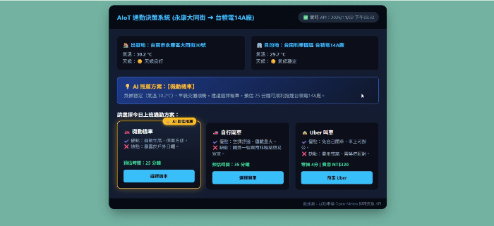

## 🎬 系統操作與動態展示 (System Demo)
> 
#  AIoT 智慧通勤與環境感知決策系統
> **GitHub Repository:** [roxcychen-oss/aiot-commute-decision-dashboard](https://github.com/roxcychen-oss/aiot-commute-decision-dashboard)

  
   
  <b>📱 手機掃描即刻體驗智慧通勤系統</b>

---

## 📌 1. 專案背景與架構動機 (Project Overview)
本專案旨在解決真實生活場景中的高維度通勤決策痛點（以台南永康至南科台積電14A廠為例）。擺脫傳統靜態網頁，
系統透過串聯**即時開放環境數據（Open-Meteo API）**與**動態地理資訊系統（Google Maps API）**，
打造一套兼具即時數據採集、條件式狀態機運算、以及外部服務生態系串聯的互動式決策儀表板，展現扎實的軟體工程實務與 PM 系統規劃能力。

---

## 🛠️ 2. 核心系統架構與運算邏輯 (Architecture & Logic)

* **多點非同步資料採集層 (Multi-Point Asynchronous Ingestion)**
  * 同時對起點與目的地發起平行非同步請求 (`async/await`)。
  * 內建 **2.5秒超時防禦與邊緣備用運算邏輯 (Fallback Logic)**，確保網路受限時系統自動切換至離線預測，展現企業級軟體的強固性 (Robustness)。
* **動態環境感知與決策引擎 (Context-Aware Decision Engine)**
  * 即時解析氣象與濕度代碼，透過布林邏輯判定降雨與道路濕滑係數 (`isRaining`)。
  * 動態計算機車、開車與 Uber 的時間成本與候車時間，驅動 UI 狀態機自動高亮 **AI 最佳推薦方案**。
* **情境式外部服務與路由規劃 (Spatial Routing Integration)**
  * 結合 Google Maps Directions API 進行多點路徑規劃（起點 ➔ 順路早餐補給點 ➔ 目的地）。
  * **智慧防呆與法規對應**：自動偵測交通工具類型，強制為機車模式套用平面道路與避開高速公路參數 (`travelmode=two_wheeler`, `avoid=highways,tolls`)，
  * 並精準過濾掉不合時宜的內用早午餐點。

---

## 💡 3. 系統特色 (Key Highlights)

1. **真實世界數據轉化**：讓外部環境感測數值（溫濕度、降雨氣象碼）直接介入系統決策樹，落實 AIoT 感知與決策核心精神。
2. **極致的系統強固性**：具備嚴謹的異常攔截與離線防禦機制，體現對系統穩定度與使用者體驗的細膩要求。
3. **高擴展性模組化設計**：純函數與狀態物件分離架構，具備高度擴展性，可無縫對接生成式 AI 語意分析或 RAG 知識檢索模組。

---

